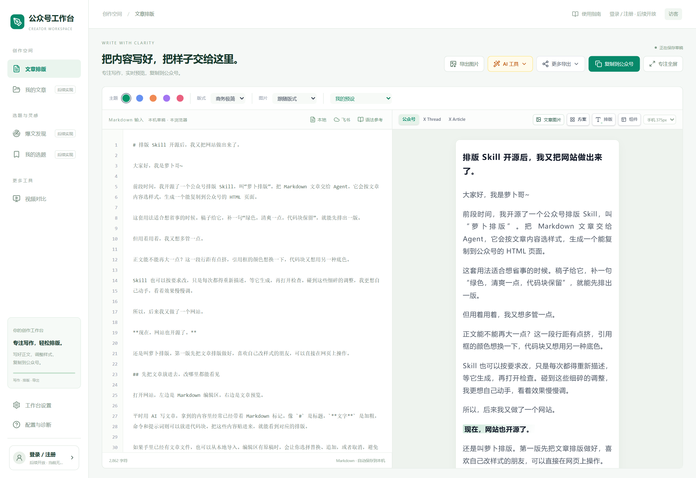
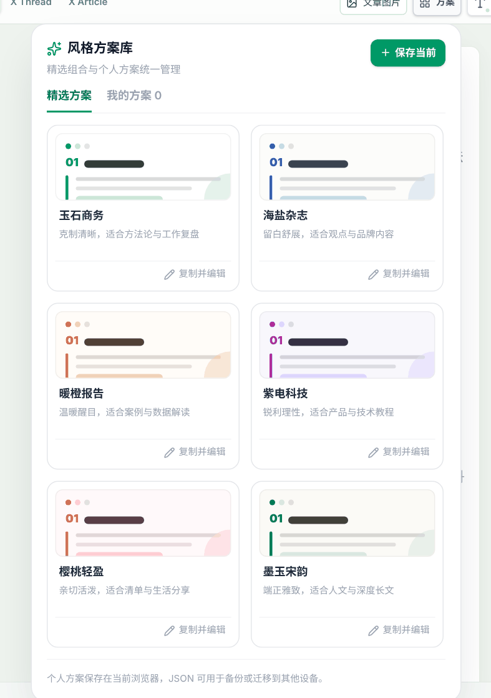
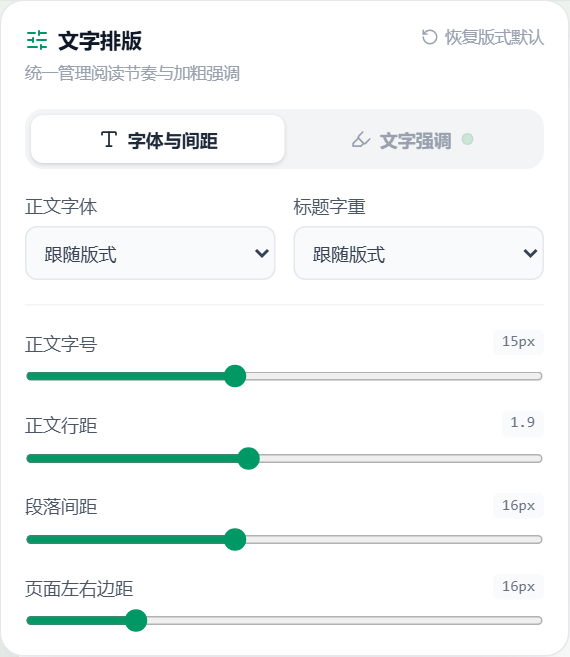
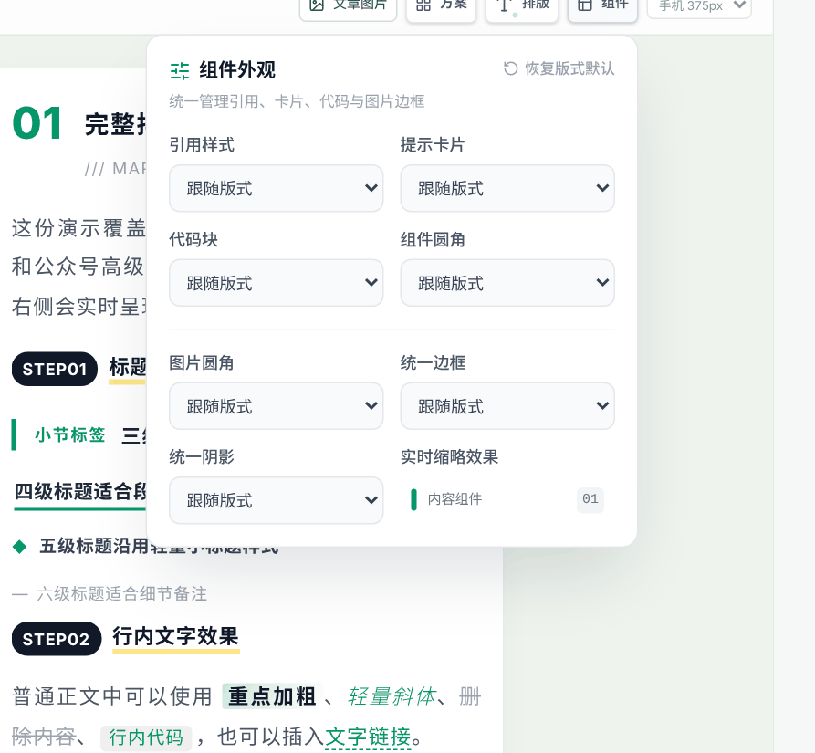
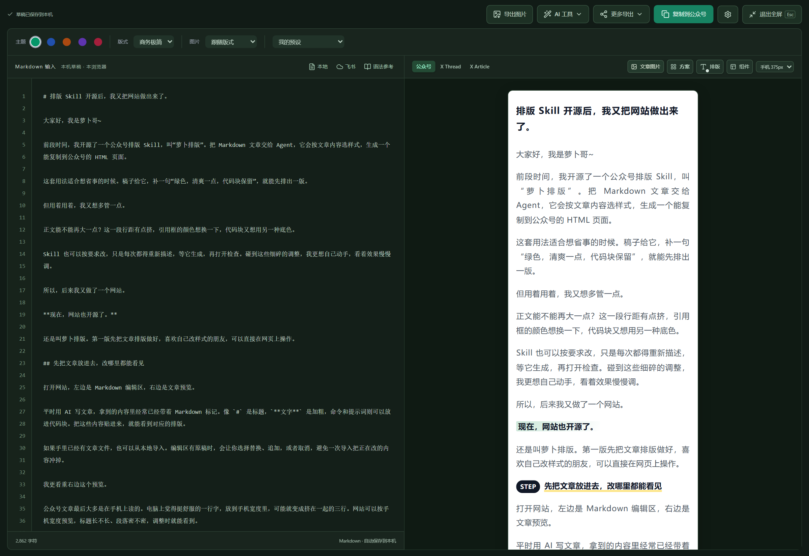
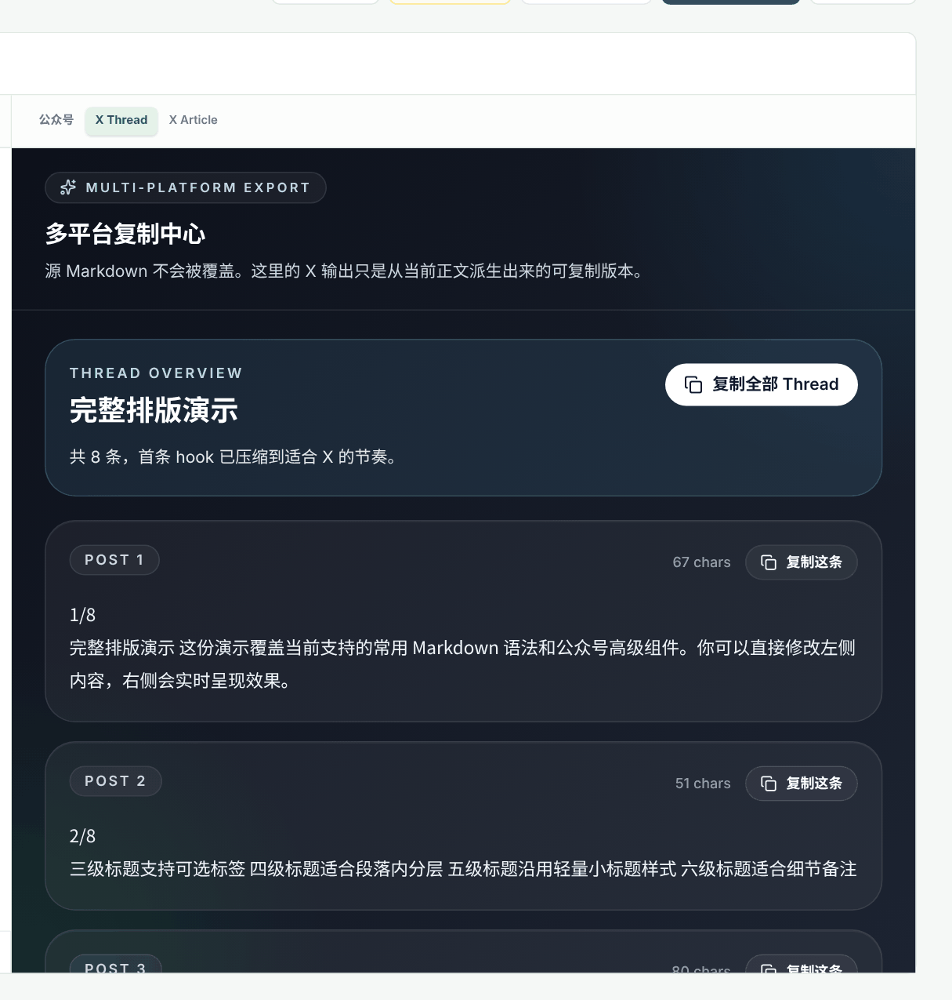
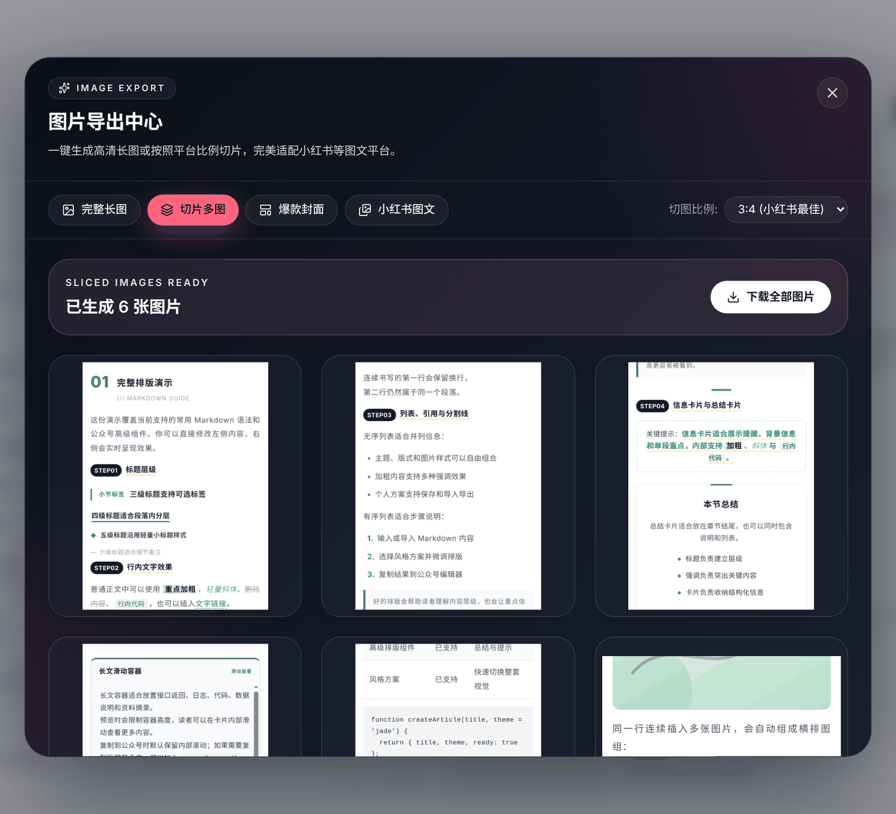
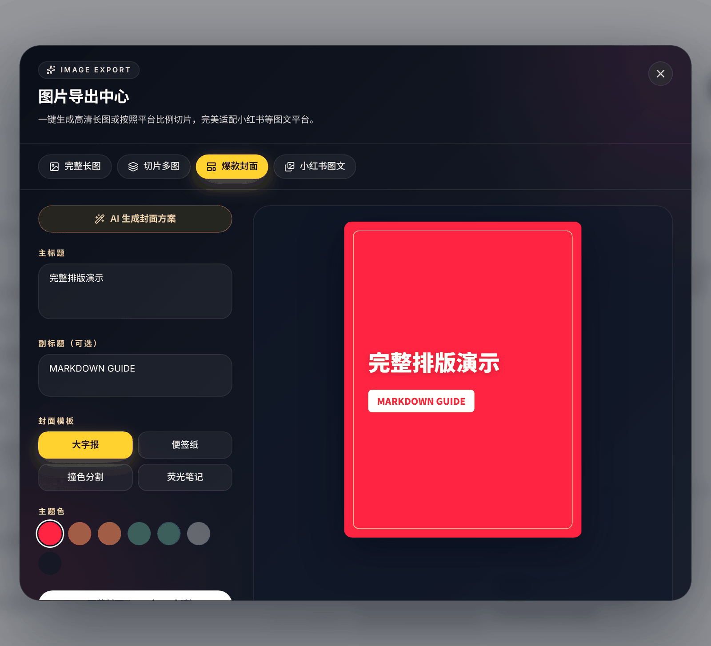
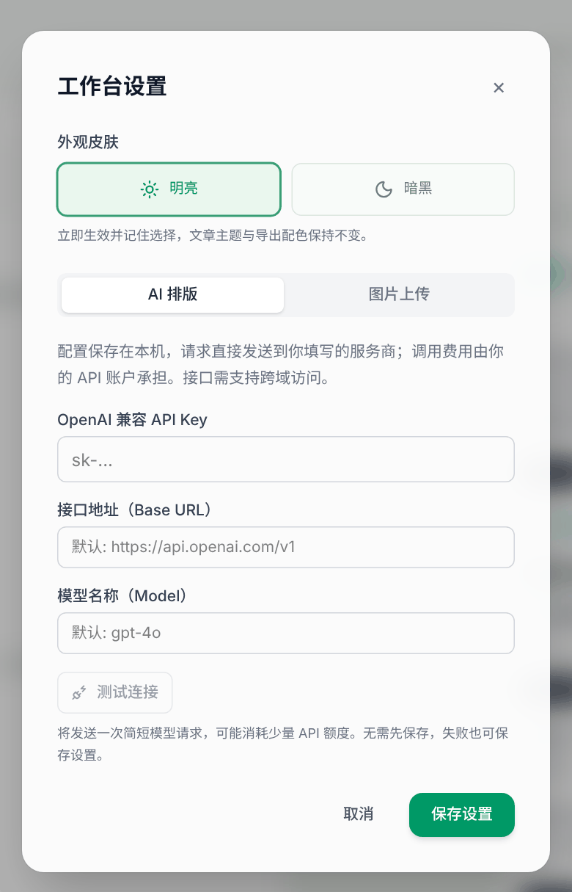
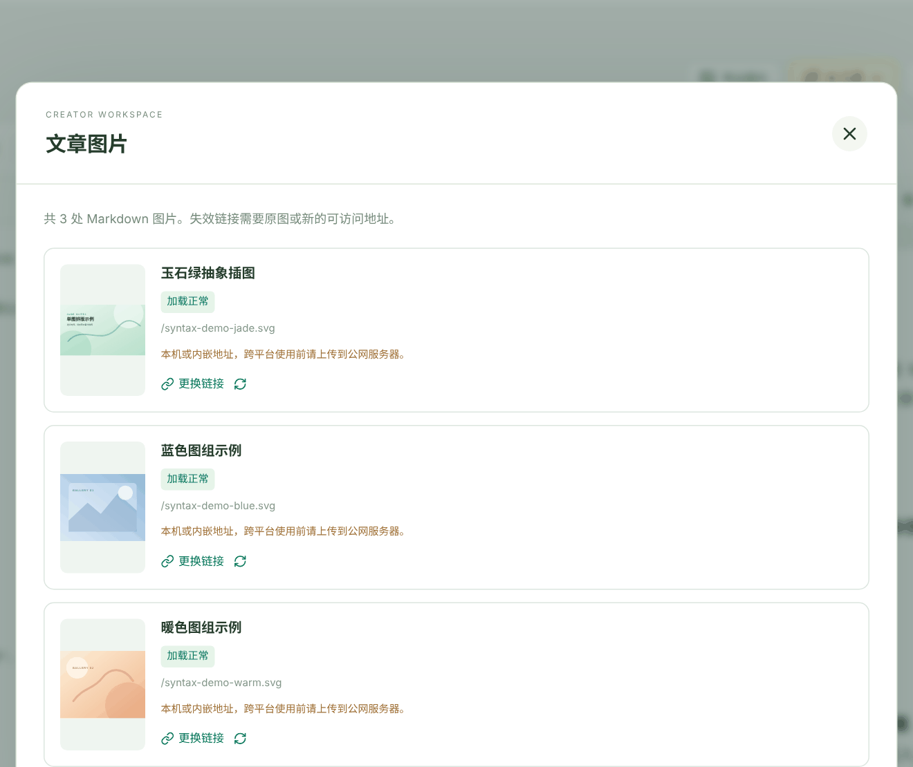

# 公众号排版工作台 · Windows 桌面版

在左边写 Markdown，右边实时看到公众号排版效果，一键复制到公众号后台；同一篇文章还能导出长图、切片、封面和小红书图文，或拆成 X（Twitter）Thread。

所有内容都保存在本机，不需要注册登录。只有用到 AI 功能时，才会用你自己填写的 API 联网调用。



**目录**：[下载安装](#下载安装) · [五分钟上手](#五分钟上手) · [功能详解](#功能详解) · [排版语法速览](#排版语法速览) · [排版 Skill](#排版-skill给-ai-agent-用) · [数据与隐私](#数据与隐私) · [常见问题](#常见问题) · [开发与发布](#开发与发布)

---

## 下载安装

1. 打开 [Releases](https://github.com/tony2015116/gzh-design/releases)，下载最新的 `LuoboGzh-Setup-<版本>-x64.exe`。
2. 双击运行，按向导选择安装目录。
3. 从开始菜单或桌面打开「公众号排版工作台」。

说明：

- 仅支持 Windows x64。安装包已自带运行环境，不需要另装 Node.js 或浏览器。
- 安装包没有数字签名，Windows 可能提示“未知发布者”或被 SmartScreen 拦截，点「更多信息 → 仍要运行」即可。
- 升级时直接安装新版本覆盖即可，草稿、方案和设置都会保留。

## 五分钟上手

1. **写正文**：在左侧编辑区输入或粘贴 Markdown。已有文件可点编辑区上方的「本地」导入 `.md` / `.txt`。
2. **选风格**：点预览区上方的「方案」，从九套精选风格方案里挑一套；也可以在顶部单独换主题色、版式和图片样式。
3. **微调**：用「排版」调整字号、行距、段落间距和边距，用「组件」调整引用、卡片、代码块和图片的外观。
4. **复制**：点右上角绿色的「复制到公众号」，到公众号后台编辑器里直接粘贴（`Ctrl+V`）。
5. **检查**：在公众号后台预览一遍，尤其注意图片是否都能显示。

正文会自动保存到本机，关掉软件再打开，内容还在。

---

## 功能详解

### 编辑与导入

- **自动保存**：右上角会显示「草稿已保存到本机」。
- **导入文件**：「本地」按钮支持 2 MB 以内的 `.md` / `.txt` 文件。导入前会先预览，可以选「替换正文」或「追加到末尾」。
- **粘贴图片**：在编辑区直接 `Ctrl+V` 粘贴截图，图片会被压缩后插入正文。插入方式取决于[图片上传设置](#图片上传设置)：默认是 Base64，也可以配置自己的图床。
- **撤销整篇替换**：导入替换、AI 排版、应用配图这类整篇改动之后，「AI 工具」菜单里会出现「撤销：……」，可以恢复到改动前。
- **语法参考**：编辑区上方的「语法参考」会打开速查表，每个语法都有示例，并带「复制语法」按钮。

### 风格方案、主题与版式

顶部工具栏可以单独切换 **主题色**（翠绿、海蓝、日落、皇家紫、樱桃红）、**版式**（商务极简、文艺清新、科技未来、活泼可爱、古典中式、杂志风、暗黑风）和 **图片样式**。

「方案」打开风格方案库。一套方案就是版式、主题色、强调样式、字体字号和组件样式的完整组合：

| 风格方案库 | 文字排版 | 组件外观 |
| --- | --- | --- |
|  |  |  |

- **精选方案**：玉石商务、海盐杂志、暖橙报告、紫电科技、樱桃轻盈、墨玉宋韵，以及三套营销方案：爆款种草（清单、种草）、专业信赖（分析、案例）、走心故事（个人经历、品牌故事）。点卡片即可套用，点「复制并编辑」会在它的基础上生成你自己的方案。
- **我的方案**：把当前调好的效果「保存当前」为个人方案，最多 30 套，支持改名、删除，以及 **JSON 导入 / 导出**。导出的 JSON 可以换电脑恢复，也可以直接给[排版 Skill](#用桌面版调好的方案) 使用。
- **排版**：「字体与间距」调正文字体、标题字重、字号、行距、段落间距和页面边距；「文字强调」调加粗内容的效果和强调颜色。
- **组件**：分别设置引用（含适合放金句的「金句大字」）、提示卡片、代码块的样式，以及组件圆角、图片圆角、统一边框和阴影。
- **预览宽度**：右上角可切换「手机 375px」和「宽屏 677px」。

### 外观皮肤与专注全屏

在「工作台设置」里可以切换 **明亮 / 暗黑** 皮肤。皮肤只改变软件界面，不影响文章本身的配色和导出效果。

「专注全屏」会收起周围的按钮和栏目，只留下编辑区和预览区，按 `Esc` 退出。



### 复制到公众号

点「复制到公众号」后，软件会先做一遍公众号兼容检查，再把富文本写进剪贴板：

- 提示「复制成功」：直接去公众号后台粘贴。
- 提示「已复制，请核对内容」：说明发现了可能有问题的地方，比如本机图片地址、加载失败的图片，粘贴后请重点检查。
- 提示「已复制纯文本」：说明富文本写入失败，剪贴板里只有文字，没有样式。请重试一次。

### 导出到 X（Twitter）

预览区上方可以切换到「X Thread」和「X Article」：

- **X Thread**：自动把文章拆成若干条推文，第一条会压缩成适合 X 的开头。可以「复制全部 Thread」，也可以逐条复制。
- **X Article**：生成 X 长文版本，标题和正文分开复制。

顶部的「更多导出」菜单里也有「复制 X Thread」和「复制 X Article」。



### 图片导出中心

点「导出图片」打开，有四种模式：

| 模式 | 用途 |
| --- | --- |
| **完整长图** | 把整篇预览导出成一张长图 PNG。 |
| **切片多图** | 按比例切成多张图，支持 3:4（小红书最佳）、1:1、4:3、16:9，可以一次全部下载。 |
| **爆款封面** | 填写主标题、副标题，选封面风格和主题色，生成封面图。「AI 生成封面方案」可以根据正文自动提炼标题文案（需要配置个人 API）。 |
| **小红书图文** | AI 把文章拆成一组小红书卡片，有多种卡片风格可选（需要配置个人 API）。 |

| 切片多图 | 爆款封面 |
| --- | --- |
|  |  |

### AI 工具

AI 功能都使用你在「工作台设置 → AI 排版」里填写的个人 API（见[下一节](#个人-api-设置)）。

- **AI 一键排版**：先选排版偏好，比如小标题拆得细不细、加粗多少、要不要金句引用和分割线、要不要总结或信息卡片，也可以补充其他要求。AI 返回后会弹出确认窗口，可以对比「排版效果」和「改动对比」，再决定「采用结果」还是「放弃结果」。采用后仍可撤销。
- **智能配图建议**：分析文章，建议在哪些位置插入什么类型的信息图（流程图、对比图、时间线、框架图等）。勾选需要的条目后，软件会在本机生成 PNG 并插入正文。配置个人 API 后，配图内容会更贴合文章。

### 个人 API 设置

打开「工作台设置 → AI 排版」，填写：

| 字段 | 说明 |
| --- | --- |
| OpenAI 兼容 API Key | 你的服务商密钥，例如 `sk-...` |
| 接口地址（Base URL） | 默认 `https://api.openai.com/v1`。其他兼容 OpenAI 接口的服务商填它们的地址。 |
| 模型名称（Model） | 默认 `gpt-4o`，按服务商实际提供的模型填写。 |

填好后可以先点「测试连接」，它会发一次很短的请求，并显示响应状态和耗时。不保存也能测，测试失败也可以先保存。



注意：

- 请求由软件直接发给你填写的服务商，费用从你自己的 API 账户扣。
- 服务商接口必须允许跨域访问（CORS），否则测试连接会失败。
- API Key 只保存在本机，不会写进导出的方案或文章里。

### 图片上传设置

「工作台设置 → 图片上传」决定粘贴进编辑区的图片怎么处理：

- **Base64（默认）**：图片压缩后直接嵌在正文里，不需要任何服务器。适合本机预览和导出图片。粘贴到公众号后，请确认图片能正常显示。
- **自定义 CDN**：把图片上传到你自己的图床。需要填写「上传接口 URL」，可选填「图片字段名」（默认 `file`）、「额外请求头（JSON）」（例如 `{"Authorization":"Bearer xxx"}`）和「URL 提取路径」（从返回的 JSON 中取图片地址，例如 `data.url`）。上传失败时会自动退回 Base64。

### 文章图片检查

预览区上方的「文章图片」会列出正文里的所有图片，并检测每张能否加载。失效的图片可以直接「更换链接」。本机地址的图片会被标出来，因为发到公众号或其他平台之前，需要先换成公开的图片地址。



---

## 排版语法速览

标准 Markdown 都能用，另外有一些专门为公众号设计的写法。完整说明见 [Markdown 语法参考](docs/syntax_tutorial.md)，软件里的「语法参考」也能随时查。

**标题**：用 `|` 分隔编号、标题和副标题，效果更好。

```markdown
# 01 | 主标题 | 一句话副标题
## STEP 01 | 小节标题
### 标签 | 三级标题
```

**文字**：`**加粗**`、`*斜体*`、`~~删除线~~`、`` `行内代码` ``、`[链接文字](https://…)`。

**图片**：单独一行一张；同一行写 2–3 张会自动横排成图组。

```markdown


 
```

**卡片组件**：组件标签要单独占一行。

```markdown
<CoverCard kicker="AI 观察" title="用好 AI 的三个习惯" subtitle="从提问到复盘">
导语：一两句话说清这篇讲什么。
</CoverCard>

<TocCard />

<InfoCard title="前置条件">
一段提示或注意事项。
</InfoCard>

<SummaryCard title="带走清单">
- 要点一
- 要点二
</SummaryCard>

<ScrollCard title="接口返回" height="220">
很长的内容，在固定高度内上下滑动……
</ScrollCard>

<AuthorCard name="你的署名">
一句个人简介
</AuthorCard>
```

| 组件 | 作用 |
| --- | --- |
| `CoverCard` | 开篇封面，放在全文最前面 |
| `TocCard` | 本文导读；不写条目时自动提取二级标题 |
| `InfoCard` | 提示、前置条件、注意事项 |
| `SummaryCard` | 章节或全文总结，`- ` 开头的行会变成要点列表 |
| `ScrollCard` | 长日志、长数据，在固定高度内滑动 |
| `LongImageCard` | 超长截图，复制到公众号时默认展开 |
| `AuthorCard` | 文末签名，附带“点赞、在看、转发”引导语 |

不支持：`==高亮==`、脚注、数学公式，以及 `<div>`、`<style>` 等任意 HTML 标签。

---

## 排版 Skill（给 AI Agent 用）

仓库里的 [`skills/luobo-gzh-design`](skills/luobo-gzh-design) 是一个排版 Skill，用的是和桌面版**同一套排版引擎**。

适用场景是让 AI 代劳排版：把文章交给 Claude Code、Codex、Cursor 等 AI Agent，Agent 会判断文章类型、推荐风格方案、改写标题并补充合适的组件，最后生成一个 HTML 页面。在浏览器里打开这个页面，点「复制到公众号」，就能粘贴到公众号后台。

桌面版和 Skill 的区别：

| | 桌面版 | Skill |
| --- | --- | --- |
| 谁来排版 | 你自己，所见即所得 | AI Agent 根据文章自动排 |
| 产物 | 软件内实时预览，直接复制 | 一个带「复制到公众号」按钮的 HTML 文件 |
| 依赖 | 安装 exe | Node.js 18 及以上，不用 `npm install`，不用联网 |
| 风格方案 | 九套精选方案 + 我的方案 | 同样的九套方案，也能读取桌面版导出的方案 JSON |

安装包里不包含 Skill，需要单独从仓库获取。

### 安装到 Agent

先把仓库下载到本地，`git clone` 或在 GitHub 页面点「Code → Download ZIP」都可以。然后把 `skills/luobo-gzh-design` 整个文件夹复制到 Agent 能读取的位置：

- **Claude Code**：放到 `~/.claude/skills/luobo-gzh-design/`（所有项目都能用），或项目里的 `.claude/skills/luobo-gzh-design/`（只在该项目用）。Agent 会读取其中的 `SKILL.md`。
- **Codex、Cursor、WorkBuddy、Windsurf、Cline 等**：放进你的项目目录，并让 Agent 按文件夹里的 `AGENTS.md` 工作。比如在对话里说“按 `skills/luobo-gzh-design/AGENTS.md` 的流程排版这篇文章”。

### 在对话中使用

装好后直接用自然语言提要求：

- “把 `article.md` 排成公众号可以粘贴的 HTML”
- “用海盐杂志风格排版，加上封面和文末签名”
- “这是一篇工具盘点，帮我排一下，风格你来定”

Agent 会按 Skill 里的流程工作：

1. 读文章，判断类型（教程、清单、评测、观点、心得、资讯）。
2. 推荐一个首选风格和一个备选风格，让你选；你说“你定”，它就直接排。
3. 把原文改写成带排版语法的新文件 `<原名>.typeset.md`，**不会改动原文件**，也不会编造原文没有的内容。
4. 渲染出 HTML，并自动做公众号兼容检查。
5. 告诉你用了哪个方案、做了哪些处理，以及产物路径。

拿到 HTML 后，用浏览器打开，点页面右上角「复制到公众号」，到公众号后台粘贴即可。

### 不通过 Agent，直接用命令行

装了 Node.js 18 以上就能直接运行。在 `skills/luobo-gzh-design` 目录下：

```bash
# 查看所有风格方案
node scripts/typeset.mjs --list-schemes

# 把 Markdown 渲染成可复制的 HTML
node scripts/typeset.mjs --input 文章.md --scheme 海盐杂志 --title "文章标题" --out 文章.html

# 单独检查某个 HTML 是否兼容公众号
node scripts/validate.mjs 文章.html
```

| 参数 | 说明 |
| --- | --- |
| `--input` | 要渲染的 Markdown 文件（必填） |
| `--scheme` | 方案 id 或中文名，默认 `jade-business`（玉石商务） |
| `--layout` / `--theme` | 在方案基础上单独换版式或主题色，例如 `--theme sunset` |
| `--scheme-file` | 桌面版「我的方案」导出的 JSON 文件 |
| `--title` | 生成页面顶栏显示的标题 |
| `--out` | 输出路径，默认与输入文件同名、扩展名为 `.html` |

兼容检查通过时退出码为 0。退出码为 2 表示有错误，通常是 Markdown 里手写了 HTML，改成上面的标准语法后重新渲染即可。

九套方案的 id：

| id | 中文名 | 适合 |
| --- | --- | --- |
| `jade-business` | 玉石商务 | 方法论、复盘、工具测评（拿不准就用它） |
| `ocean-editorial` | 海盐杂志 | 观点长文、品牌内容、书评 |
| `amber-report` | 暖橙报告 | 案例拆解、数据解读 |
| `violet-tech` | 紫电科技 | 技术教程、产品发布 |
| `cherry-friendly` | 樱桃轻盈 | 清单好物、生活分享 |
| `jade-classic` | 墨玉宋韵 | 人文随笔、读书笔记 |
| `marketing-pop` | 爆款种草 | 清单干货、种草、想要高转发的文章 |
| `marketing-trust` | 专业信赖 | 行业分析、案例拆解、方法论 |
| `marketing-story` | 走心故事 | 个人经历、品牌故事、情感文 |

### 用桌面版调好的方案

在桌面版「方案 → 我的方案」里导出 JSON，交给 Skill 使用，就能得到和桌面版一样的效果：

```bash
node scripts/typeset.mjs --scheme-file my-schemes.json --list-schemes
node scripts/typeset.mjs --input 文章.md --scheme-file my-schemes.json --scheme "我的方案名"
```

在 Agent 对话里，直接告诉它这个 JSON 文件的路径就行。

Skill 的完整说明见 [SKILL.md](skills/luobo-gzh-design/SKILL.md)，语法、方案和兼容规则在 [references/](skills/luobo-gzh-design/references) 目录下。

---

## 数据与隐私

- 正文草稿、风格方案、外观皮肤、个人 API 设置和图床设置都只保存在本机的软件数据目录里（一般是 `%APPDATA%\公众号排版工作台`），不会上传到任何服务器。
- 软件只在三种情况下联网：调用你配置的 AI 接口、上传到你配置的图床、加载正文里的网络图片。
- 草稿只保留当前一份，加上最近一次整篇替换前的撤销快照，**没有历史版本**。重要文章请另存成 `.md` 文件。
- 卸载软件默认不会删除数据目录。要彻底清除数据，卸载后手动删除上面的目录。
- 导出的方案 JSON 不包含 API Key。

## 常见问题

**粘贴到公众号后图片不显示？**
公众号只能显示公开可访问的网络图片。本机路径的图片肯定不行；Base64 图片能不能用，以公众号后台的实际显示为准。最稳妥的做法是用 `https://` 图片链接，或配置自定义图床。用「文章图片」可以一次检查全部图片。

**测试连接失败？**
先确认 Key、Base URL 和模型名称都正确。如果这三项都没问题，多半是服务商不允许跨域访问（CORS），换一个支持跨域的服务商或中转接口即可。

**复制后公众号里格式乱了？**
确认提示的是「复制成功」，而不是「已复制纯文本」。不要在 Word 等其他软件里中转，直接粘贴到公众号编辑器。

**换电脑怎么迁移？**
把正文另存为 `.md` 文件，再从「方案 → 我的方案」导出 JSON。到新电脑上导入这两样即可。API Key 需要重新填写。

---

## 开发与发布

需要 Node.js 22.22.2 或 24 LTS。

```bash
cd app
npm ci
npm run dev          # 浏览器里开发调试
npm run build
npm run start:desktop  # 以桌面版运行
```

提交前检查（CI 也会执行，任一失败都不会打包 EXE）：

```bash
npx tsc -b
npm run lint
npm test
```

在 Windows 的 `app/` 目录运行 `npm run package:win`，可以在本地打出 x64 安装包，产物在 `app/release/`。首次构建需要联网下载 Electron 和 NSIS。

**自动打包与发布**：推送到 `development` 分支或提交 PR 时，GitHub Actions 会检查并打包，安装包在对应运行页面的 Artifacts 里，但不会发布 Release。要发布 Release，推送一个 `desktop-v` 开头的标签，版本号直接取自标签：

```bash
git tag desktop-v0.2.0
git push origin desktop-v0.2.0
```

新版本号必须比上一次大，安装时才会被识别为升级。

**更新 Skill**：排版组件、解析器或风格方案改动后，在 `app/` 下运行 `npm run build:skill`，重新生成 `skills/luobo-gzh-design/scripts/` 里的渲染引擎。

| 目录 | 内容 |
| --- | --- |
| `app/` | 桌面版源码（React + TypeScript + Vite + Electron） |
| `app/desktop/` | Electron 主进程 |
| `skills/luobo-gzh-design/` | 排版 Skill |
| `docs/` | 语法参考与截图 |

---

本项目 fork 自 [zhouwei713/luobo-gzh-design](https://github.com/zhouwei713/luobo-gzh-design)，在其基础上改为 Windows 本地桌面版。
